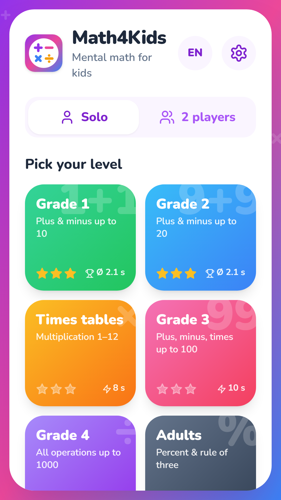
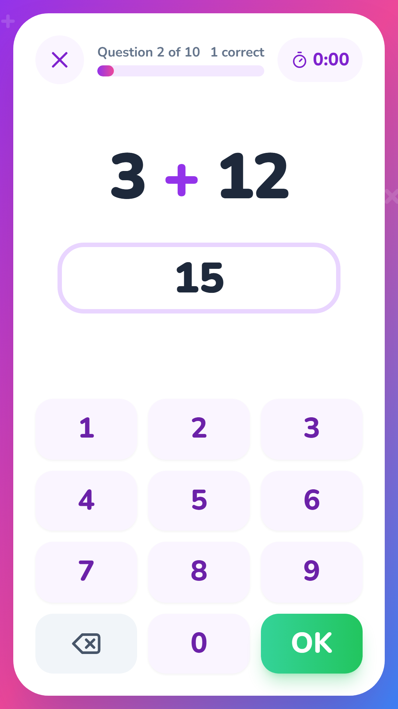
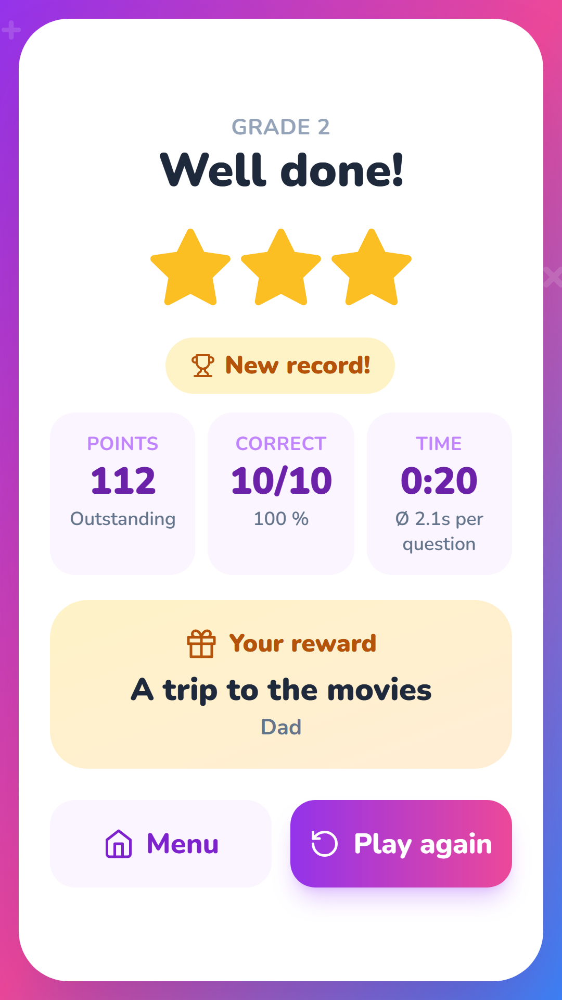
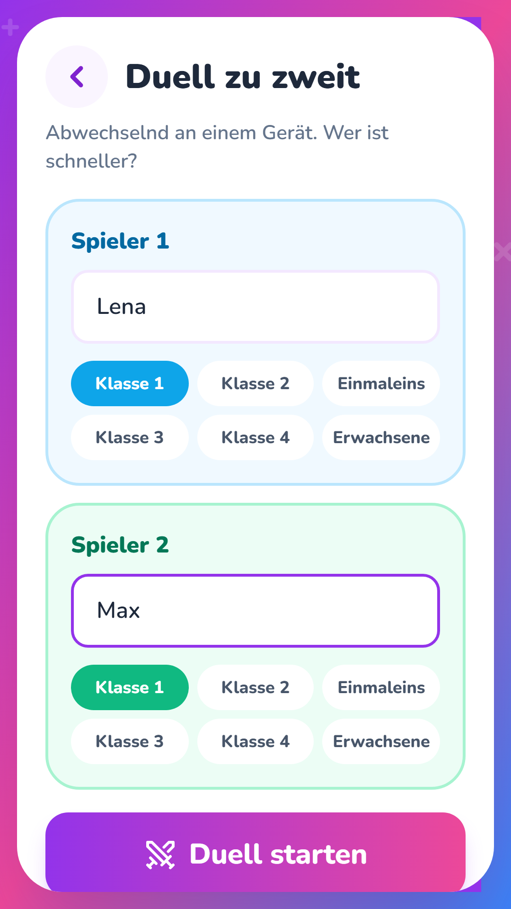

# 🧮 Math4Kids - Mental Math Learning App

[](https://github.com/schurick1502/Math4Kids/releases)
[](LICENSE)
[](https://github.com/schurick1502/Math4Kids/releases/latest)
[-4285F4?style=flat-square&logo=googlechrome&logoColor=white)](https://schurick1502.github.io/Math4Kids/)
[](https://react.dev/)
[](https://vitejs.dev/)

<p align="center">
  
</p>

A motivating Progressive Web App (PWA) and native Android app for children in grades 1-4 to practice mental math.

## 📥 Download

### Android APK
| Version | Language | Download |
|---------|----------|----------|
| v1.2.0 | 🇩🇪 German + 🇬🇧 English | **[⬇️ Download](https://github.com/schurick1502/Math4Kids/releases/latest/download/Math4Kids-v1.2.0.apk)** |
| v1.1.0 | 🇬🇧 English | [⬇️ Download](releases/Math4Kids-v1.1.0-english.apk) |
| v1.0.0 | 🇩🇪 German | [⬇️ Download](releases/Math4Kids-v1.0.0.apk) |

All versions: [GitHub Releases](https://github.com/schurick1502/Math4Kids/releases)

### Web App
**[🌐 Try the Web App](https://schurick1502.github.io/Math4Kids/)** - Runs directly in your browser (German & English)

## 📸 Screenshots

<p align="center">
  
  
  
  
</p>

## ✨ Features

### 🎯 Game
- **6 levels**: Grade 1 (± up to 10), Grade 2 (± up to 20), Times tables (1–12), Grade 3 (+, −, × up to 100), Grade 4 (all operations up to 1000), Adults (percent & rule of three)
- **Big on-screen number pad** – no fiddly system keyboard
- **5, 10, 15 or 20 questions** per round with live timer and target time per question
- **Up to 3 stars** per round and **personal records** per level
- **2-player duel** on one device with automatic hand-over

### 🏆 Motivation
- **Rewards** for good rounds (three reward levels, editable by parents)
- **Fun tasks** for rounds that did not go so well (editable)

### 🌍 Languages
- **German and English** – follows the device language, switchable in the app

### 🔒 Privacy
- No ads, no tracking, no account – everything stays on the device ([privacy policy](https://schurick1502.github.io/Math4Kids/privacy-policy.html))

### 📱 Platforms
- **Android app** (Capacitor 8, Android 7–16)
- **Progressive Web App** – installable and offline-capable

## 🚀 Quick Start

### Prerequisites
- **Node.js** (Version 16 or higher)
- **npm** or yarn
- For Android: **Android Studio** and **JDK**

### 1. Clone and Install Project

```bash
git clone https://github.com/schurick1502/Math4Kids.git
cd Math4Kids
npm install
```

### 2. Start Development Server

```bash
npm run dev
```

The app will run at `http://localhost:5173`

## 📦 Deployment Options

### 🌐 Web App (PWA)

#### Option A: Local HTTP Server
```bash
npm run build
npm run serve:dist
```
The app runs on `http://localhost:8080` and is accessible on the local network.

#### Option B: USB Stick Installation
1. Run `npm run build`
2. Copy `dist/` folder to USB stick
3. Open `index.html` on smartphone

See `QUICKSTART-USB.md` for details.

#### Option C: Install PWA
1. Open app in browser (via HTTPS)
2. Select "Add to Home Screen"
3. App can be used offline

See `PWA-INSTALLATION.md` for details.

### 🤖 Android App

#### Create Debug APK
```bash
npm run apk:debug
```
APK located at: `android/app/build/outputs/apk/debug/app-debug.apk`

#### Create Release APK (signed)
```bash
npm run apk:release
```
APK located at: `android/app/build/outputs/apk/release/app-release.apk`

#### Create AAB for Google Play Store
```bash
npm run aab:release
```
AAB located at: `android/app/build/outputs/bundle/release/app-release.aab`

**⚠️ Important:** A keystore must be configured for release builds.
See `SETUP-SIGNING.md` for details.

### 📱 Android Studio Development

```bash
npm run build:android  # Build and Sync
npm run android        # Open Android Studio
```

See `ANDROID-INSTALLATION.md` for complete guide.

## 📚 Detailed Guides

### 🚀 Quick Start Guides
- `START-HERE.md` - Complete Android setup guide
- `QUICKSTART-HTTP-SERVER.md` - Local HTTP Server
- `QUICKSTART-USB.md` - USB Stick Installation
- `HOW-TO-START-APP.md` - Overview of all methods

### 🤖 Android
- `ANDROID-INSTALLATION.md` - Complete Android Setup Guide
- `APK-BUILD.md` - Create APK (detailed)
- `APK-QUICKSTART.md` - Create APK (quick)
- `AAB-COMPLETE.md` - Create AAB for Play Store
- `SETUP-SIGNING.md` - Set up Keystore and Signing
- `CREATE-KEYSTORE.md` - Create Keystore Step by Step
- `ANDROID-STUDIO-FIX.md` - Troubleshoot Common Issues

### 🌐 Web & PWA
- `PWA-INSTALLATION.md` - Install PWA
- `CHROME-PERMISSIONS.md` - Chrome Permissions for PWA
- `CREATE-ICONS.md` - Create App Icons

### 🛠️ Tools
- `generate-android-icons.html` - Icon Generator for Android

## 🛠️ Technology Stack

### Frontend
- **React 18** - UI Framework
- **Vite** - Build Tool (fast, optimized)
- **Tailwind CSS** - Utility-first CSS Framework
- **lucide-react** - Icon Library

### Mobile
- **Capacitor** - Native Mobile Bridge
- **Android** - Native Android Support

### Build & Optimization
- **Terser** - JavaScript Minification
- **Code Splitting** - Optimized Bundle Size
- **Service Worker** - Offline Functionality
- **Performance Optimization** - Adapted for older devices

### Storage
- **localStorage** - Persistent Data Storage in Browser

## 📂 Project Structure

```
Math4Kids/
├── public/
│   ├── index.html          # HTML Template
│   ├── manifest.json       # PWA Manifest
│   ├── service-worker.js   # Service Worker for Offline
│   └── icon-*.png          # App Icons
├── src/
│   ├── App.jsx            # Main Component with complete logic
│   ├── main.jsx           # Entry Point
│   └── index.css          # Global Styles (Tailwind)
├── android/                # Android Project (Capacitor)
│   ├── app/
│   │   ├── src/main/      # Android Source Code
│   │   └── build.gradle   # Android Build Config
│   └── gradle.properties  # Gradle Settings
├── capacitor.config.json   # Capacitor Configuration
├── vite.config.js         # Vite Build Configuration
├── tailwind.config.js     # Tailwind Configuration
├── server.js              # HTTP Server for local use
├── package.json           # Dependencies & Scripts
└── README.md              # This file
```

## 📋 Available Scripts

### Development
```bash
npm run dev          # Start Development Server
npm run build        # Create Production Build
npm run preview      # Test Production Build locally
```

### Web Server
```bash
npm run serve        # HTTP Server (Root Directory)
npm run serve:dist   # HTTP Server (dist/ Directory)
```

### Android
```bash
npm run build:android   # Web Build + Android Sync
npm run android         # Open Android Studio
npm run sync:android    # Android Sync only
npm run apk:debug       # Create Debug APK
npm run apk:release     # Create Release APK
npm run aab:release     # Create AAB for Play Store
```

## 🎨 Creating Icons

The app requires icons in various sizes. See `CREATE-ICONS.md` for details.

**Quick Summary:**
1. Open `generate-android-icons.html` in browser
2. Generate icons
3. Save them in the `public/` folder

## 🧪 Testing

### Web Version
- [x] Play through all 4 grade levels
- [x] Add/delete rewards
- [x] Add/delete penalty tasks
- [x] Check timeout behavior
- [x] Use up lives
- [x] Achieve 90%+ score
- [x] Achieve below 90% score
- [x] Test offline functionality
- [x] Test PWA installation

### Android Version
- [x] Install APK on device
- [x] Create AAB for Play Store
- [x] Configure signing
- [x] Test performance on older devices

## 🐛 Known Issues & Solutions

### Issue: App won't install (PWA)
**Solution:** PWAs only work over HTTPS. Use a hosting service (Netlify, Vercel) or the local HTTP server.

### Issue: Data is lost
**Solution:** Make sure the browser doesn't delete cookies/localStorage. In private browsing modes, data is not saved.

### Issue: Android Studio won't open
**Solution:** See `ANDROID-STUDIO-FIX.md` for troubleshooting.

### Issue: Gradle Build fails
**Solution:**
1. Check if JDK is configured correctly
2. Delete `.gradle` and `build` folders
3. Run `npm run build:android` again

### Issue: "Keystore not found"
**Solution:** See `CREATE-KEYSTORE.md` for instructions on creating a keystore.

## 💡 Tips for Parents

### Personalization
- Add your child's favorite rewards
- Customize penalty tasks to suit age and interests
- Keep penalty tasks playful and motivating

### Usage
- Start with the appropriate grade level (not too hard!)
- Practice regularly, but in short sessions (10-15 minutes)
- Celebrate successes together!

### Performance
- The app is optimized for older devices
- If problems occur: Reduce animations in browser settings
- Use the PWA version for best performance

## 🤝 Contributing

Suggestions for improvements and bug reports are welcome!

1. Fork the repository
2. Create a feature branch
3. Commit your changes
4. Push to the branch
5. Open a Pull Request

## 📝 License

This project is open source and freely available.

## 🙏 Acknowledgments

- **React Team** for the great framework
- **Vite Team** for the fast build tool
- **Capacitor Team** for the Native Mobile Bridge
- **Tailwind CSS** for the Utility-First CSS Framework

---

## 🚀 Next Steps

1. **Clone:** `git clone https://github.com/schurick1502/Math4Kids.git`
2. **Install:** `npm install`
3. **Start:** `npm run dev`
4. **Develop:** Have fun! 🎉

**Have fun with mental math! 🎉**
